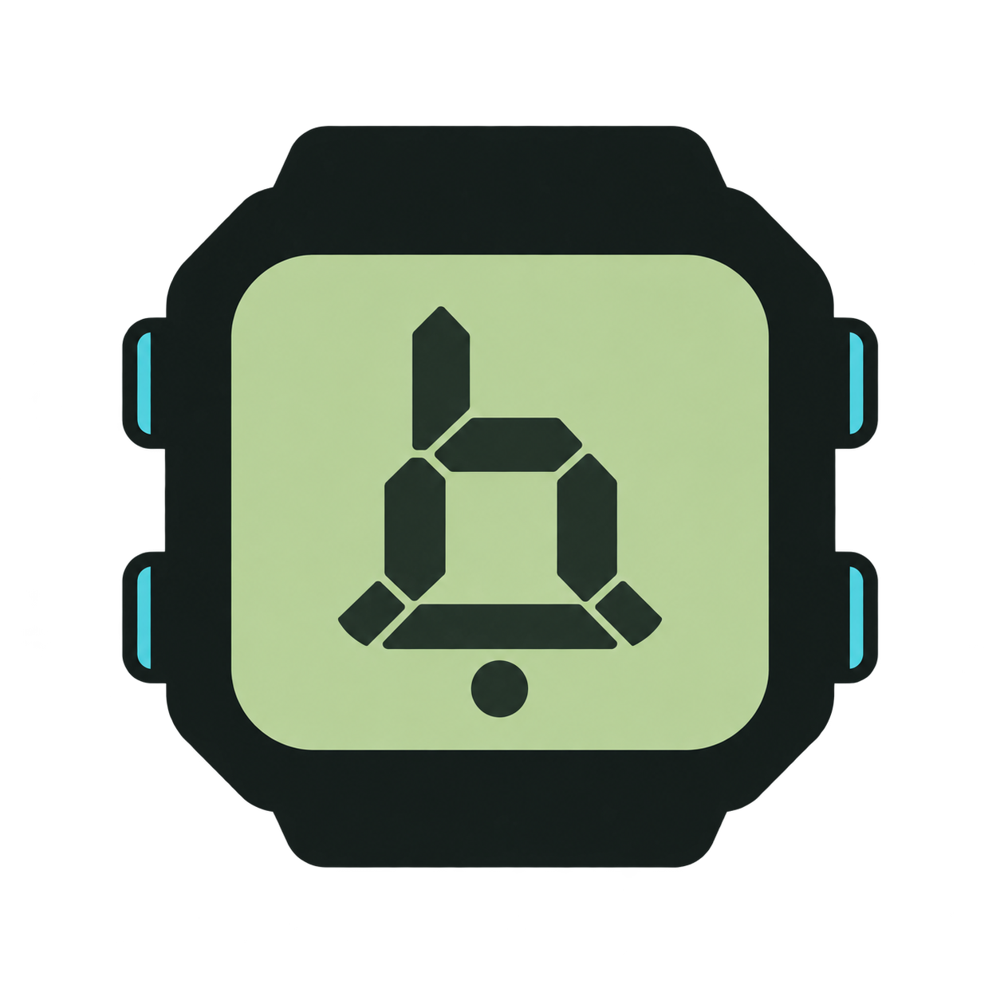
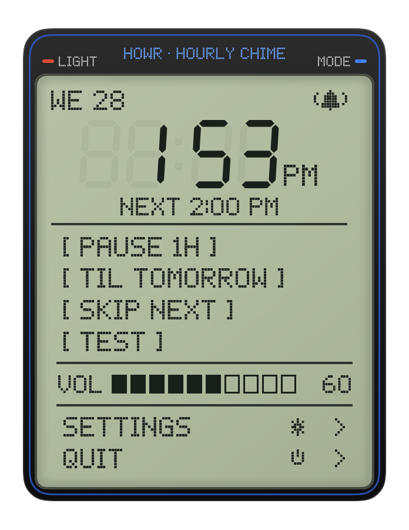
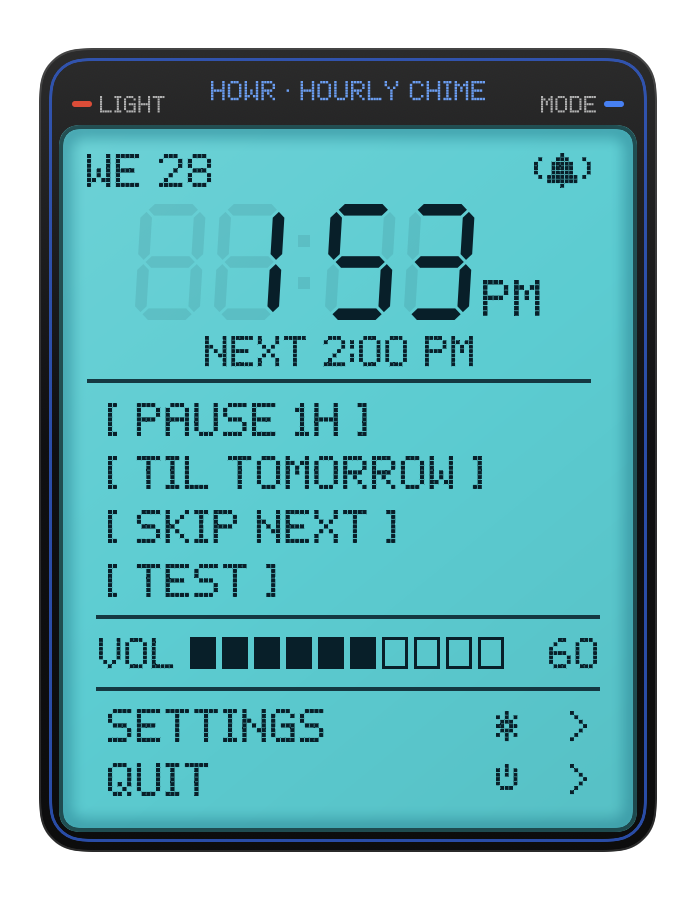

# Howr

An hourly chime for your Mac's menu bar, with the LCD face of a digital watch. Free, open source, and MIT licensed.

**macOS 14 or later · Apple silicon and Intel · [Project page](https://lmostafa.dev/howr) · [Downloads](https://github.com/Skheiller/howr/releases/latest)**

 

## Install

### Homebrew

```sh
brew install --cask skheiller/tap/howr
```

This uses [our custom tap](https://github.com/Skheiller/homebrew-tap), not the official Homebrew cask catalog. The cask pins the release ZIP's SHA-256 checksum.

### Terminal, without Homebrew

```sh
curl -fsSL https://raw.githubusercontent.com/Skheiller/howr/main/scripts/install.sh | /bin/bash
```

The [installer](scripts/install.sh) downloads the latest universal ZIP, checks its SHA-256, app identifier and signature, and installs to `/Applications` (or `~/Applications` if needed). It does not use `sudo`, launch the app, remove quarantine attributes or change Gatekeeper. To inspect it first, download the script instead of piping it into Bash. Quit a running Howr before upgrading.

### Download the app

Get **`Howr-<version>-universal.dmg`** from [Releases](https://github.com/Skheiller/howr/releases/latest). Open the disk image, drag **Howr.app** onto the **Applications** shortcut, then eject the image. Open Howr from Applications. The bell appears in the menu bar; Howr does not use a Dock icon.

The release also includes ZIPs for the terminal installer and Homebrew. You do not need those for the usual drag-to-Applications installation.

**First launch:** current releases are ad-hoc signed and **not Apple-notarized**. If macOS blocks the app, first try opening it, then review **System Settings → Privacy & Security → Open Anyway**. Approve only if you trust the download. Managed Macs may prohibit this. See [Apple's instructions](https://support.apple.com/102445). No paid Apple Developer account is required to install or build Howr.

To verify a downloaded DMG, download `SHA256SUMS` from the same release and compare its listed hash with:

```sh
shasum -a 256 Howr-1.0.2-universal.dmg
```

Checksums detect corruption; ad-hoc signing does not identify an Apple-verified publisher.

## What it does

- Chimes every 15, 30 or 60 minutes. Choose a synthesized chirp, soft beep, cuckoo, bell, Westminster or singing bowl, a macOS alert sound, or a voice announcing the time.
- Set volume, active hours and weekdays. Pause for an hour or until tomorrow, skip the next chime, or test a sound.
- Optionally stay quiet when the screen is locked or a microphone is in use. This checks audio activity without recording it or requesting microphone access. On macOS 14.0–14.1 the check is limited to the default input device.
- Switch the display between daylight, cyan backlight and system appearance with **LIGHT** or `L`.
- Enable **Launch at login** from Settings after moving the app into Applications. If approval is needed, follow the Settings link.

Howr makes no network requests and has no accounts, telemetry or automatic updater. The agent arms one timer for the next event. UI and audio run in short-lived processes so their drawing and audio caches are released when they exit. Sleeping Macs are not woken for a chime, and missed chimes are not replayed after waking. Exact timing can vary under system load.

## Keyboard controls

| Surface | Keys |
| --- | --- |
| Menu | ↑↓ / Tab move; ←→ volume; Space / Return activate; `,` Settings; Esc close |
| Settings | ↑↓ / Tab move; ←→ change; Space / Return select; Esc / ⌘W close |
| Both | `L` cycles automatic, daylight and backlight |
| Active hours | Click hour/minute digits to advance; ⌥-click to go back |

## Update and uninstall

For a Homebrew install, quit Howr and run:

```sh
brew update && brew upgrade --cask skheiller/tap/howr
```

For a manual or terminal install, quit Howr and download the newest release or rerun the installer. Preferences survive replacement.

Before uninstalling, turn off **Launch at login**, then quit Howr. Use `brew uninstall --cask skheiller/tap/howr`, or move Howr.app to the Trash. Preferences are stored in the `app.howr.Howr` defaults domain; the agent lock is under `~/Library/Application Support/Howr`. Homebrew's `--zap` option removes these local settings too.

## Build and contribute

Requires macOS 14+ and Xcode command-line tools, with Swift 5.9 or later. There are no third-party package dependencies.

```sh
git clone https://github.com/Skheiller/howr.git
cd howr
swift test
scripts/build.sh --run
```

`scripts/build.sh` creates an ad-hoc-signed universal `build/Howr.app`. `VERSION` controls the app version; `HOWR_BUILD_NUMBER` overrides its numeric bundle build number. `scripts/release.sh` verifies the app and produces the DMG, ZIPs, checksums and release manifest. It mounts the DMG read-only, checks the app and Applications shortcut, then verifies a copied app. macOS CI runs the tests and universal build; a `v<VERSION>` tag publishes only after verification succeeds.

See [Contributing](CONTRIBUTING.md), [Security](SECURITY.md) and the [changelog](CHANGELOG.md).

## Download statistics

GitHub records aggregate download counts for each release asset. Starting with
v1.0.2, the website uses the DMG, Homebrew uses `-homebrew.zip`, and the terminal
installer uses `-universal.zip`, so these distribution paths have separate counters.
Maintainers can read all release counts with Python 3 and an authenticated GitHub CLI:

```sh
python3 scripts/download-stats.py
```

These are file downloads, not unique people or confirmed installations. They
include verification downloads and retries; someone downloading an asset directly
on GitHub is counted under that asset too. v1.0.0's ZIP combined all methods and
cannot be split retrospectively. The native app sends no telemetry.

`Howr --snapshot <new-directory>` renders the native screens to PNG. The screenshots above are native renders. Other artwork under `design/landing/` is generated concept artwork, as its manifests record. Use a new dated folder for captures to preserve existing references.

## License

[MIT](LICENSE), copyright 2026 Lmostafa A. El Alaoui. Howr is an independent project and is not affiliated with Casio or Apple.
